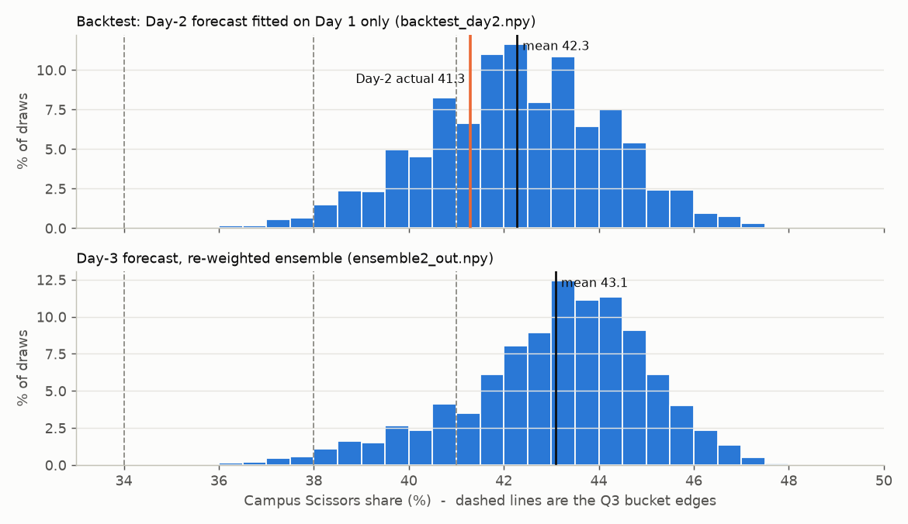

# The Field: modelling a campus-wide rock-paper-scissors game

Three days of forecasting how ~500 IIT Bombay students would play a weighted rock-paper-scissors game, and turning those forecasts into answers for four scored questions each day.

## What it is

"The Field" (run as part of DaVinci, in this folder) was a three-day game played by the whole campus. Each player was assigned one of six payoff tables, e.g. my table was Rock 3 / Paper 5 / Scissors 9, and 34% of the field shared it. Each day had four questions, all driven by one unknown number, the campus-wide share of Scissors:

- **Q1 Mix:** split 100 throws across R/P/S. A move's value is `payoff x (share of the move it beats) / (its own share + 0.25)`, and the score is `100 * (w . v) / max(v)`.
- **Q2 Market:** quote a bid and offer (spread at least 10) on the campus Scissors %, trading against every other player's quote.
- **Q3 Buckets:** spread 100 points over the bands `<30 | 30-34 | 34-38 | 38-41 | >=41`. You get a deviation score, but it is ranked as a percentile against the field.
- **Q4 Markets:** buy, sell or leave four fixed markets ((5,10), (15,20), (25,30), (35,40)), scored as clamped profit over the total positive profit available.

The published aggregates were R 30.7 / P 32.5 / S 36.9 on Day 1 and R 25.7 / P 32.9 / S 41.3 on Day 2. The three daily scores were summed.

## What I did

Each day lives in its own folder, and each one is a self-contained set of small scripts plus the saved simulation outputs.

**Day 1 (`r-1/`):** `field_core.py` sets up the payoff tables, value multipliers, level-k ladders and Poisson cognitive-hierarchy (CH) profiles. `v1_verify.py` checks the formula against the worked example from the game page (values 1.714 / 2.857 / 5.143, a 50/50 R-P mix scoring 44.4). `mc.py` / `run_mc.py` then Monte-Carlo the joint distribution of (sR, sP, sS) under several behavioural models (level-k, level-k + equilibrium, CH), and I blended those into `blend12.npy`. `an1`-`an6`, `game2*.py` and `verify_final.py` turn that distribution into answers and re-derive the key numbers in closed form. For example, I solved the exact Paper/Scissors flip threshold as a quadratic. Day 1 went well: all-in on 34-38 for Q3 landed on 36.9 (deviation 0).

**Day 2 (`r-2/`, writeup in `r-2/ANSWERS.md`):** I refit the field to the Day-1 aggregate. A free L0/L1/L2/L3 mixture fit Day 1 almost exactly (L1 error 0.0010), compared with 0.0203 for a two-type naive/sharp model, and I ran a 467-agent simulation (`mc2.py`, `pop.py`). Final block: Q1 100% Scissors, Q3 `0/0/55/40/5`, Q4 Buy/Buy/Buy/Leave. On Q3 I argued for a hedge over all-in because the score is a *rank* against a correlated LLM-using bloc. In simulation `(0,0,55,40,5)` reached E[percentile] 60.0, against 49.9 for pure modal. On Q4 I scored all 81 combinations with the real clamp-and-ratio function rather than raw profit.

**Day 3 (`r-3/`, writeup in `r-3/ANSWERS.md`):** Day 2 exposed a real miss. I forecast Scissors at 38.4 and it came in at 41.3, which put my Q3 in the wrong bucket (deviation 190, 37.1st percentile). So the first job was a post-mortem:
- `core.py` reproduces the worked example and all of my Day-2 ground-truth scores (Q1 100, Q4 98.0, Q3 deviation 190).
- `fit2day.py` fits both days. Poisson-CH is rejected on Day 2 (L1 error 0.11 vs 0.001 for the free mixture). The field looked like L0 → L1 *recruitment* (L0 69% → ~35%), with almost no level-2 play.
- `br_analysis.py` / `llm_chain.py` found the structural change for Day 3. At the published Day-2 numbers, the (5,9,3) table's best response flips from Paper to Rock by a 2% margin (Rock 4.073 vs Paper 3.995). That depends on whether students paste the results into an LLM.
- Agent Monte-Carlos `mc3`/`mc4`/`mc5`/`mc6` (several seeds, plus "V1-heavy" and "V2/V3-heavy" prompt priors), six trend models in `trend.py`, and `ensemble.py`/`ensemble2.py` to combine them.
- `backtest.py` checks the machinery honestly: fit on Day 1 only, it predicts Day 2 at S 42.3 (actual 41.3, right bucket).
- `q3cal.py` calibrates an opponent-field model against my real Day-2 percentile. `q3rank.py` then searches Q3 allocations by E[percentile] (logs `q3_*.log`), and `q2cal.py`/`q2sim.py`/`q2v2.py`/`q2grid.py` sweep Q2 quotes over bull/bear scenarios and three execution conventions.

Final Day-3 block (v3.2): Q1 `0/50/50`, Q2 bid 40 / offer 50, Q3 `0/0/0/25/75`, Q4 Buy ×4. The central forecast was Scissors 43.1. The writeup keeps a changelog (v1 → v3.2) and lists flip thresholds for each answer.


*Simulated campus Scissors share: the Day-1-only backtest of Day 2 against the actual 41.3 (top) and the final Day-3 ensemble forecast (bottom). Plotted from the saved `r-3/backtest_day2.npy` and `r-3/ensemble2_out.npy` outputs.*

## What I learnt

- **My Day-2 model was confidently wrong, and the cause was structural.** Poisson-CH ties level-2 mass to level-1 mass, and level-2 play drags Scissors down. That one modelling choice cost me the Q3 bucket. Fitting a free mixture across two days showed level-2 was only 2-3%. Next time I'd test a model family's assumptions against the data before trusting its forecasts.
- **Backtest whatever you can.** On Day 3 I made the model retrodict Day 2 from Day-1 data only before using it. Trend models can't be backtested from one point, so I weighted them with that in mind.
- **Optimise the actual score function, not a proxy.** Q3's deviation score is minimised all-in, but its *percentile* rank isn't. Q4's ratio scoring made "Leave" the aggressive play on Day 2. In both cases the naive answer was beaten only once I simulated the real scoring rule.
- **Some uncertainty can't be identified.** On Day 3 I could not tell from the data whether students paste results into an LLM. So instead of guessing, I chose a Q1 mix (50/50) whose expected score stayed flat across the models that disagreed.
- **Verify the plumbing first.** Every round starts by reproducing the game's worked example. By Day 3, it also reproduces my own past scores. That way I knew the base was right before building on top of it.
- **Process:** dozens of tiny scripts with `.npy`/`.pkl`/`.log` outputs were fast under time pressure but are hard to navigate afterwards. The `FILES` section in `r-3/ANSWERS.md` is the map I wish I'd kept from Day 1.

## Repo structure

```
r-1/   Day 1: field_core.py (model), mc.py / run_mc.py (Monte-Carlo), an1-an6.py, game2*.py,
       v1-v3 / verify_final.py (checks); blend12.npy, mc_out.npz, s_eq.npy (saved draws)
r-2/   Day 2: ANSWERS.md (writeup), core.py, fit.py, pop.py, mc2.py, q134.py, q2fast.py,
       q23.py, q3final.py, stress.py; *.npy / *.pkl results
r-3/   Day 3: ANSWERS.md (writeup), core.py, fit2day.py, br_analysis.py, llm_chain.py,
       mc3-mc6.py, trend.py, ensemble*.py, backtest.py, q1sens.py, q2*.py, q3*.py, q4.py;
       *.npy simulation outputs, q3res_*.pkl rank results, *.log run logs
```

## How to run

Only NumPy is needed. Each round is self-contained, so run the scripts from inside that round's folder (they load sibling `.npy` files by relative path):

```bash
pip install numpy
cd r-3
python core.py          # formula + Day-2 ground-truth checks, prints "CORE VERIFIED"
python fit2day.py       # two-day behavioural fit
python mc4.py 0 100000  # agent MC (seed, draws) -> mc4_*_s0.npy
python backtest.py
```

In `r-1/`, start with `python v1_verify.py`, then `python run_mc.py` (regenerates `mc_out.npz`) and the `an*.py` analyses. Large Monte-Carlo runs can take a while. Their outputs are committed, so the downstream analysis scripts can run without them.
